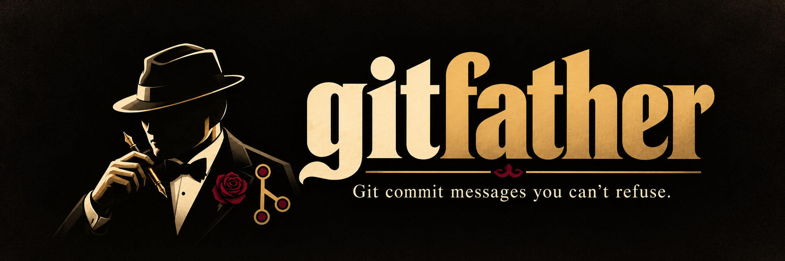
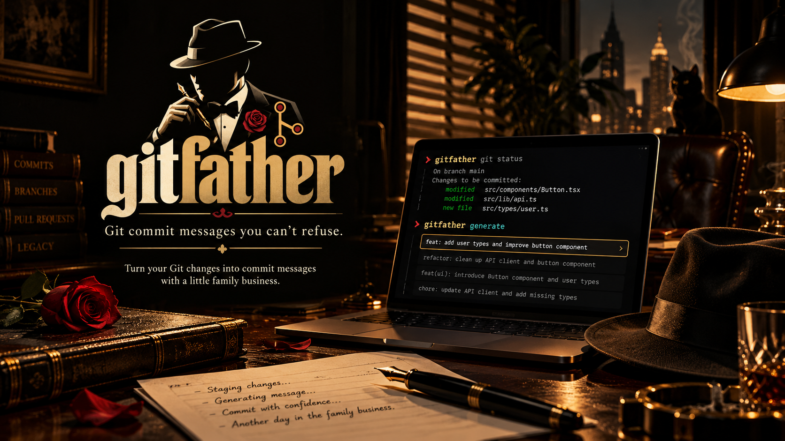

# 🎩 gitfather

<p align="center">
  
</p>

[](#-license)
[](#-features)
[](#-examples)
[](#-how-it-works)

> **Git commit messages you can't refuse.**
> Respect your diffs. Your commit history should look like family business, not a cry for help.

`gitfather` is a CLI that reads your staged Git diff and writes the commit message your changes deserve — accurate, Conventional, and delivered in the quiet voice of a Don Corleone who has reviewed your code and found it... acceptable.

Because `fix stuff` ships. `fix stuff` also sleeps with the fishes once the Don sees your `git log`. 🚬

---

## 🕴️ What is this?

You know how Don Corleone listens carefully, looks at you with warm eyes, and says exactly what business must be done? Imagine that, but for your Git commits.

`gitfather` looks at what you've changed, understands what you actually did, and makes the commit message an offer it can't refuse.

- No more boring commit messages.
- No more staring at your terminal trying to explain 47 changed files.
- Just precise Conventional Commits, delivered with a quiet menace.

---

## 🚬 How it works

```bash
$ gitfather

  gitfather   🎩
  ───────────────────────────────
  Git commit messages you can't refuse.

  🚬 Reading the family's staged changes...
  🐈 Consulting the consigliere...
  🍷 Making the model an offer...

  ✨ The message is written. Nothing personal.

  ╭───────────────────────────────────────────────────────────────────────╮
  │ feat(auth): validate token expiry before trusting a session, the      │
  │ tokens were living on borrowed time                                   │
  │                                                                       │
  │ Expired tokens were walking straight in. Nothing personal; the door   │
  │ is closed now.                                                        │
  ╰───────────────────────────────────────────────────────────────────────╯
  model: deepseek-v4-pro

  Commit this? [y/N]
```

*You write the code. The Don dictates the message.*

---

<p align="center">
  
</p>

## 🥂 Features

- 🎩 **Don-grade commit messages** — Turn ordinary Git diffs into family-business commit messages.
- 🚬 **Diff-aware generation** — Messages are based on what actually changed. The Don does not speculate; he reads the books first. (The books are your staged diff.)
- 🐈 **Quiet old-world menace** — A little respect, a little cannoli commentary, no shouting.
- ⚡ **Terminal-first** — No unnecessary UI. Just you, Git, and the family.
- 🔒 **The books stay closed** — Credential-looking diffs are refused before anything is sent anywhere.
- 🤝 **Less thinking, more business** — Spend less time naming commits and more time shipping code.

---

## 📦 Installation

Not on npm yet. Install from a clone:

```bash
npm install
npm run build
npm link
```

`npm link` puts `gitfather` on your PATH. Node.js 20 or newer, plus Git on your PATH.

gitfather talks to a running [ModelHitch](https://github.com/genoventures-labs/ModelHitch) bridge. The bridge holds your provider credentials, so gitfather never needs a key of its own:

```bash
modelhitch bridge --background
modelhitch status
```

Any OpenAI-compatible endpoint works instead, through `GITFATHER_BASE_URL` or `--base-url`.

---

## 🤝 Usage

Stage what you want committed, then run gitfather from anywhere inside the repository:

```bash
cd your-project
git add .
gitfather
```

Let the Don conduct business.

```bash
gitfather                 # generate, preview, ask, then commit
gitfather --dry-run       # look at the message, never commit
gitfather --yes           # commit straight away, no questions asked
gitfather --plain         # professional message, zero mob theatrics
```

| Flag | What it does |
|---|---|
| `--dry-run` | Print the message without creating a commit |
| `-y, --yes` | Commit without the confirmation prompt |
| `--plain` | Humor-free message, delivered in a boring suit |
| `--model <id>` | Pin a model, for example `deepseek-v4-flash` |
| `--base-url <url>` | Point at a different bridge |
| `--max-diff-chars <n>` | Cap how much of the diff gets sent |
| `--allow-secrets` | Send the diff even when it looks like it holds credentials |
| `-h, --help` | Usage information |
| `-v, --version` | Installed version |

gitfather only reads the staged diff. Unstaged changes are never touched, and nothing is committed without confirmation unless you pass `--yes`.

If the staged diff looks like it contains a real credential, gitfather names the file and refuses to send anything. The family does not discuss secrets with strangers. `--allow-secrets` overrides it — do not come crying later.

## ⚙️ Configuration

gitfather reads the environment. It writes nothing to disk, and it never prints a key.

| Variable | Default | Meaning |
|---|---|---|
| `GITFATHER_BASE_URL` or `MODELHITCH_BASE_URL` | `http://127.0.0.1:3939/v1` | Bridge URL. `MODELHITCH_HOST` and `MODELHITCH_PORT` also work |
| `GITFATHER_MODEL` | unset | Model id. Unset lets ModelHitch rotate across its own lanes |
| `GITFATHER_API_KEY` | unset | Only needed if your bridge requires one |
| `GITFATHER_TIMEOUT_MS` | `60000` | Request timeout. The Don will not be kept waiting |
| `GITFATHER_MAX_DIFF_CHARS` | `120000` | Diff budget sent to the model |
| `GITFATHER_MAX_SUBJECT_LENGTH` | `72` | Limit for the first line |

Not built yet: a `gitfather config` command and a settings file. Environment and flags are the whole story for now.

---

## 🍝 Examples

**You finally fixed a bug:**
```text
fix(queue): stop retrying when the queue is empty, the retry loop was an offer it couldn't refuse
```

**You added a feature:**
```text
feat(theme): add dark mode, now the bugs can hide in the dark too
```

**You refactored your spaghetti code:**
```text
refactor(parser): split the tokenizer, old friends were too close together
```

**You deleted 2,000 lines:**
```text
chore: drop dead helpers, they sleep with the fishes now
```

**You fixed something you broke yesterday:**
```text
fix(api): restore the retry guard, leave the blame, take the fix
```

---

## 🎬 Why gitfather?

Because every repository deserves commit messages with respect. `git` + `godfather`.

The Don's promises:

- **Accuracy first.** The flourish is a bow at the end, never the meal.
- **No fabricated features.** The Don only speaks of what the books show.
- **Never repeat himself.** A joke used twice is no longer funny, and the Don knows it.

Look, don't overthink it. Gitfather leaves the gun, takes the cannoli, and commits.

---

## 🤝 Contributing

Pull requests are welcome!

- Found a bug? Open an issue. Have a look around first.
- Want to add more flavor? Submit a PR.
- Writing a commit message manually? **YOU COME TO ME ON THE DAY OF A RELEASE AND ASK ME TO WRITE COMMITS BY HAND.**

Working on gitfather itself:

```bash
npm run dev -- --dry-run    # run straight from source
npm test                    # unit tests plus real git integration tests
npm run typecheck
npm run build
```

---

## ⚠️ Disclaimer

`gitfather` is an independent parody-inspired developer tool and is not affiliated with, endorsed by, or officially associated with *The Godfather*, Paramount Pictures, or Mario Puzo's estate. The tone is inspired by classic Mafia cinema, not an official collaboration.

---

## 📜 License

MIT. See [LICENSE](./LICENSE).

---

<div align="center">

Made with 🚬, quiet menace, and commit messages that respect the diff.
*No cannoli were harmed in the making of this CLI.*
**AN OFFER YOU CAN'T REFUSE. 🎩**

</div>
